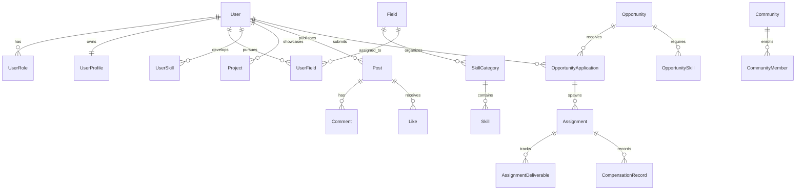

# Database Design Specification — EES

**Organization:** Provolution Technologies Pvt. Ltd.  
**Platform:** EES — Evolve, Engage & Scale  
**Engine:** PostgreSQL 16+ via Prisma ORM  
**Document Ref:** DB-SPEC-2026-v1  

---

## 1. Schema Architecture & Domain Grouping

The relational schema is cleanly divided into six coherent domain models:
1. **Identity & Access Management (IAM):** Users, Roles, Profiles, Sessions.
2. **Evolve (Skill Development & Portfolios):** Fields, Categories, Skills, UserFields, Learning Paths/Sessions, Specialized Trackers (Fitness & Content), Projects.
3. **Engage (Social & Collaboration):** Posts, Comments, Likes, Bookmarks, Communities, Direct Messages, Notifications.
4. **Scale (Commercial & Monetization):** Opportunities, Applications, Assignments, Deliverables, Ledgers, AdSense Configurations.
5. **Gamification:** XP Transactions, Levels, Streaks, Achievements.
6. **Governance & Content Management:** Blogs, Editorial Reviews, Moderation Actions, Audit Logs.

---

## 2. Entity-Relationship Overview

---

## 3. Core Relational Entities

### 3.1 Identity Domain
- **`User`**: Core account entity.
  - `id`: UUID (Primary Key)
  - `email`: VarChar (Unique, Indexed)
  - `passwordHash`: VarChar
  - `emailVerified`: DateTime (Nullable)
  - `status`: Enum (`ACTIVE`, `SUSPENDED`, `DEACTIVATED`)
  - `createdAt`, `updatedAt`: Timestamps
- **`UserProfile`**: Public & extended profile data.
  - `userId`: UUID (FK, Unique)
  - `displayName`: VarChar
  - `username`: VarChar (Unique, Indexed)
  - `avatarUrl`, `coverUrl`, `bio`: Text
  - `location`, `websiteUrl`, `githubUrl`, `linkedinUrl`: VarChar
  - `isPublic`: Boolean (Default: true)
- **`Role` & `UserRole`**: RBAC permissions matrix (`SUPER_ADMIN`, `ADMIN`, `MODERATOR`, `OPPORTUNITY_MANAGER`, `USER`).

### 3.2 Evolve Domain
- **`Field`**: Top-level areas of mastery.
  - `id`, `name`, `slug` (Unique), `description`, `icon`, `isApproved`, `isActive`.
- **`SkillCategory` & `Skill`**: Hierarchical skill taxonomy.
- **`UserField`**: Tracks user's primary and secondary fields.
  - `userId`, `fieldId`, `isPrimary` (Boolean), `startedAt`.
  - Composite Unique constraint on `[userId, fieldId]`.
- **`LearningGoal` & `LearningSession`**:
  - `durationMinutes`, `notes`, `xpEarned`, `completedAt`.
- **`FitnessGoal`, `Workout`, `Exercise`, `WorkoutSession`, `WorkoutSet`**:
  - High-precision workout tracker tables supporting reps, weightKg, RPE.
- **`ContentIdea`, `ContentDraft`, `ContentPublication`**:
  - Content creation pipeline with target platform enums (`YOUTUBE`, `LINKEDIN`, `X`, `SUBSTACK`, `CUSTOM`).
- **`Project` & `ProjectEvidence`**:
  - User project showcases with repoUrl, liveDemoUrl, evidence screenshots, and tech tags.

### 3.3 Engage Domain
- **`Post` & `PostMedia`**:
  - `authorId`, `fieldId` (Nullable for general posts), `content`, `mediaUrls`, `likeCount`, `commentCount`.
  - Indexes on `[authorId, createdAt]` and `[fieldId, createdAt]`.
- **`Comment`, `Like`, `Bookmark`, `Repost`**: Full social interaction tracking.
- **`Community` & `CommunityMember`**:
  - Communities linked to Fields with role-based member permissions (`ADMIN`, `MODERATOR`, `MEMBER`).
- **`Conversation`, `ConversationParticipant`, `Message`**:
  - Real-time 1-on-1 and group messaging with `readAt` indicators.
- **`Notification`**: Persistent event alerts.

### 3.4 Scale Domain
- **`Opportunity`**:
  - `id`, `title`, `slug`, `organization` (Default: "Provolution Technologies Pvt. Ltd."), `description`, `scope`, `opportunityType`, `compensationType`, `compensationAmount`, `currency`, `deadline`, `status` (`DRAFT`, `OPEN`, `IN_REVIEW`, `CLOSED`, `ARCHIVED`).
- **`OpportunityApplication`**:
  - `opportunityId`, `userId`, `coverNote`, `portfolioLinks`, `status` (`SUBMITTED`, `SHORTLISTED`, `SELECTED`, `REJECTED`, `WITHDRAWN`), `reviewedByUserId`, `reviewedAt`.
- **`Assignment` & `AssignmentDeliverable`**:
  - Active contract assignments with milestones, progress updates, review approvals, and completion timestamps.
- **`CompensationRecord`**:
  - Immutable ledger for payment records: `amount`, `currency`, `status` (`PENDING`, `DISBURSED`, `CANCELLED`), `referenceId`, `disbursedAt`.

### 3.5 Gamification & Governance
- **`XPTransaction`**: Immutable audit log of every XP award with action type and reference.
- **`Achievement` & `UserAchievement`**: Milestone unlocks.
- **`Blog`, `BlogCategory`**: Official editorial content for SEO and AdSense.
- **`AuditLog`**: System and administrative action audit trail.

---

## 4. Performance Indexes & Integrity Rules

1. Every foreign key relationship has an explicit foreign key index.
2. Slugs and usernames have unique B-Tree indexes.
3. Timestamps on feeds and transactions use descending indexes for lightning-fast queries (`createdAt DESC`).
4. Strict deletion rules: Soft deletes or `ON DELETE SET NULL` on auditable commercial/financial records to prevent accidental orphan cascades.
