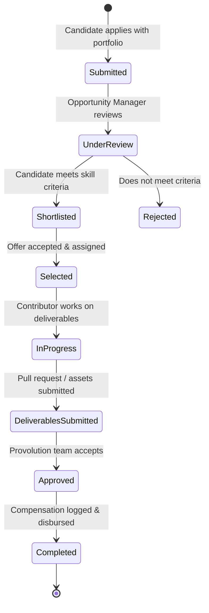

# Feature Specification Document — EES

**Organization:** Provolution Technologies Pvt. Ltd.  
**Product:** EES — Evolve, Engage & Scale  
**Document Ref:** FEAT-SPEC-2026  

---

## 1. Module A: Authentication, Identity & Onboarding

### 1.1 Authentication & Security
- **Endpoints:**
  - `POST /api/v1/auth/register`: Create user account with email/password.
  - `POST /api/v1/auth/login`: Issue access token (short-lived, 15m) and refresh token (secure HTTP-only cookie, 7d).
  - `POST /api/v1/auth/refresh`: Rotate refresh token and issue new access token.
  - `POST /api/v1/auth/logout`: Invalidate session and clear cookies.
  - `POST /api/v1/auth/forgot-password` & `POST /api/v1/auth/reset-password`: Cryptographically secure token reset flow.
- **Roles & Permissions:**
  - `SUPER_ADMIN`, `ADMIN`, `MODERATOR`, `OPPORTUNITY_MANAGER`, `CONTENT_EDITOR`, `USER`.

### 1.2 Multi-Step Guided Onboarding
1. **Step 1: Account Creation & Email Verification.**
2. **Step 2: Profile Persona:** Display name, unique username (`@handle`), avatar, concise bio.
3. **Step 3: Field Selection:** Compulsory selection of 1 primary field and optional 1 secondary field from active database taxonomy.
4. **Step 4: Objective & Skill Level Definition:** Current proficiency (`BEGINNER`, `INTERMEDIATE`, `ADVANCED`), target milestones, dedicated weekly learning hours.
5. **Step 5: Community & Discovery Orientation:** Auto-suggest relevant field-based communities and trending projects.
6. **Step 6: Scale Preview:** Transparent introduction to Provolution commercial opportunities and verification standards.
7. **Step 7: Dashboard Generation:** Instant redirect to customized Evolve workspace.

---

## 2. Module B, C, D, E, F: EVOLVE Stage Workspaces

### 2.1 Common Learning Engine (Module C)
- **Learning Goals:** User creates target milestones with deadlines and progress meters.
- **Learning Sessions:** Log study time (minutes), topics covered, notes, and links. Automatically awards calculated XP.
- **Skill Assessment & Verification:** Self-assessments linked to portfolio evidence.

### 2.2 Specialized Trackers
- **Software Development & Technical Trackers (Module B & F):**
  - Git integration: Repository URL, commits summary, branch links.
  - Project evidence: Architecture diagrams, deployment URLs, live demo embeds.
  - Skill taxonomy tags: Languages, frameworks, cloud tools.
- **Fitness Tracker (Module D):**
  - Muscle group categories, exercise catalog (Bench Press, Squat, Deadlift, Running, etc.).
  - Workout logging: Sets, reps, weight (kg/lbs), RPE, rest times, notes.
  - Personal Records (PR) history & consistency streaks.
- **Content Creation Tracker (Module E):**
  - Workflow board: `Idea → Outlined → Scripted/Drafted → Recorded/Designed → Under Review → Scheduled → Published`.
  - Channel tagging: YouTube, LinkedIn, X, Blog/Medium, Instagram.
  - Publishing calendar & live URL tracking.

---

## 3. Module G: ENGAGE Social Network

### 3.1 Field-Aware Social Feed
- Feeds:
  - `For You`: Weighted by user's primary/secondary fields + top engaged posts.
  - `Field Feed`: Filter feed dynamically by field slug (e.g. `/feed?field=software-development`).
  - `Following`: Pure chronological updates from users you follow.
  - `Showcase`: Highlighting verified user projects and milestone celebrations.
- Post Capabilities:
  - Formats: Text (markdown supported), image galleries (up to 4 images), code snippets, milestone cards.
  - Interactions: Heart/Like, Quote/Repost, Bookmark, Nested Comments (up to 2 levels depth).
  - Hashtags & Mentions: Automatic parsing of `#tag` and `@username`.

### 3.2 Communities
- Specialized hubs (e.g., "Full-Stack Architects", "AI Builders Guild", "DevOps & SRE Circle").
- Member roles: Community Admin, Moderator, Member.
- Discussions, pinned announcements, community-specific project challenges.

### 3.3 Messaging & Real-Time Sync
- 1-on-1 direct conversations.
- Unread count badges, delivery indicators, timestamped message history.
- Safety controls: Block user, report conversation.

---

## 4. Module J: SCALE Opportunity & Monetization System

### 4.1 Provolution Technologies Opportunity Catalog
- Listing fields:
  - Title, description, project type (`FREELANCE`, `CONTRACT`, `INTERNSHIP`, `BOUNTY`, `FULL_TIME`).
  - Compensation: Clearly stated (`STIPEND`, `FIXED_PRICE`, `HOURLY_RATE`, `UNPAID_LEARNING`). No misleading "get rich" promises.
  - Required skills and minimum portfolio evidence requirements.
  - Application deadline and maximum candidate seats.

### 4.2 Application & Assignment Lifecycle

### 4.3 Scale Financial Ledger
- Verified tracking of:
  - Accepted contracts.
  - Pending milestone payouts.
  - Disbursed earnings with official transaction reference IDs.
  - Strict prohibition against synthetic or speculative "estimated future revenue" metrics.

---

## 5. Module H & I: Gamification & AI Integration

### 5.1 Gamification Engine
- **Server-Side XP Verification:** XP is granted exclusively on validated actions (e.g., completing a documented learning session: +50 XP; publishing a verified project: +200 XP; submitting an approved opportunity deliverable: +500 XP).
- **Anti-Cheat:** Rate-limits on rapid repeated actions to prevent manipulation.
- **Streaks & Badges:** Consecutive daily activity tracking with freeze protection.

### 5.2 AI Assistant Layer
- Modular LLM adapter interface (`IAiService`) allowing hot-swapping between Google Gemini, OpenAI, or local models.
- Features: Study plan generation, project idea brainstorming, code explanation, resume/portfolio review for Scale opportunities.
- Guardrails: AI cannot approve applications, grant XP, or certify skills.
