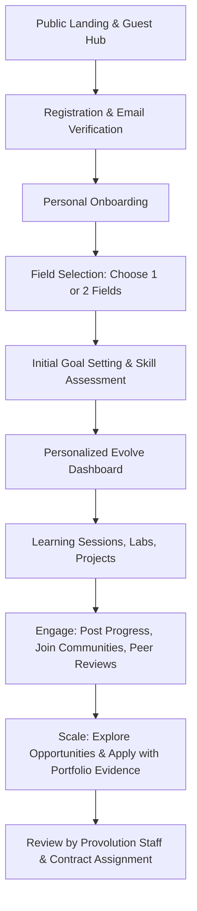

# Product Requirements Document (PRD) — EES

**Organization:** Provolution Technologies Pvt. Ltd.  
**Product:** EES — Evolve, Engage & Scale  
**Version:** 1.0.0-PROD-SPEC  
**Status:** Approved for Implementation  

---

## 1. Product Objectives & Strategy

### 1.1 Problem Statement
Most existing digital platforms segment personal learning, community networking, and monetization into disconnected silos:
1. Traditional LMS or habit-trackers isolate learners without peer collaboration or direct routes to monetization.
2. Mainstream social networks prioritize algorithmic rage bait, vanity metrics, and distraction rather than structured mastery.
3. Freelance/job marketplaces suffer from credential inflation, bidding wars, and lack of verified talent provenance.

### 1.2 The EES Solution
EES bridges this gap by enforcing an intentional three-stage lifecycle:
$$\text{EVOLVE} \xrightarrow{\quad\text{build capability}\quad} \text{ENGAGE} \xrightarrow{\quad\text{demonstrate \& collaborate}\quad} \text{SCALE} \xrightarrow{\quad\text{convert to value}\quad}$$

Users do not wander aimlessly; they commit to 1 or 2 fields, master skills with evidence, connect in authentic community feeds, and leverage proven portfolios to obtain real Provolution Technologies contracts and content monetization.

---

## 2. User Persona & Journeys

### 2.1 Personas
1. **The Aspiring Technologist / Specialist (Primary Learner):** Focuses on Software Engineering, AI, Cloud, or Cyber. Needs step-by-step roadmaps, interactive project logging, code repository validation, and portfolio proof.
2. **The Creator / Writer (Content Specialist):** Focuses on Content Creation, Design, or Digital Marketing. Needs publishing calendars, idea draft vaults, portfolio embeds, and AdSense readiness.
3. **The Physical & Holistic Achiever:** Focuses on Fitness and Physical Development. Needs workout logs, volume/PR tracking, body metrics, and training consistency.
4. **Provolution Opportunity Manager (Internal Staff):** Publishes commercial opportunities, reviews candidate portfolios, shortlists verified contributors, and tracks deliverables and compensation disbursements.
5. **Platform Administrator & Moderator:** Oversees taxonomy, content moderation, reports, audit logs, and monetization configuration.

### 2.2 End-to-End User Flow

---

## 3. Detailed Stage Requirements

### 3.1 EVOLVE (Skill Development)
- **Controlled Field Selection:** Users must choose 1 primary field and up to 1 optional secondary field upon onboarding. Fields can be changed later with history preservation.
- **Skill Progression Model:** `Discover → Learn → Practice → Build → Demonstrate → Improve`.
- **Field-Specific Modules:**
  - *Software Development / AI / Cloud:* Tech stack tagging, git repo links, live URL verification, code snippets, deployment evidence.
  - *Fitness:* Exercises, sets, repetitions, weight (kg/lbs), training duration, personal records (PRs), consistency charts.
  - *Content Creation:* Ideas pipeline, drafts, multi-platform targets (YouTube, LinkedIn, X, Substack), content calendar, publication status.
- **Portfolio Showcase:** Each user has a public/unlisted project portfolio with tech tags, project evidence, screenshots, and live demo links.

### 3.2 ENGAGE (Social Interaction & Peer Learning)
- **Field-Anchored Social Feeds:**
  - `Personalized Feed`: Algorithmic blend weighted by user's active fields and followed accounts.
  - `Field-Specific Feeds`: Dedicated streams strictly containing posts tagged with a specific field (e.g., #Cybersecurity).
  - `Following Feed`: Strict chronological stream of followed creators and collaborators.
  - `Discover Feed`: High-engagement public project showcases and discussions.
- **Post Formats:** Rich text, multi-image uploads (optimized), code blocks with syntax highlighting, project embeds, hashtags, and user mentions.
- **Interactions:** Likes, bookmarks, reposts with quotes, nested comments and replies.
- **Communities:** Public and invite/application-based groups around specialized sub-fields. Includes guidelines, moderators, and pinned announcements.
- **Direct Messaging:** End-to-end encrypted or securely stored 1-on-1 messaging with real-time delivery and read receipts.
- **Notifications:** In-app and push-ready notification system for social interactions, opportunity statuses, and achievements.

### 3.3 SCALE (Monetization & Opportunities)
- **Provolution Technologies Opportunities:**
  - Types: Paid projects, freelance contracts, internships, research bounties, content creation assignments.
  - Schema: Clear deliverables, scope, required skills, compensation range/type, timeline, and eligibility criteria.
  - Application Workflow: `Submitted → Under Review → Shortlisted → Selected / Rejected → In Progress → Submitted Deliverable → Completed & Paid`.
- **Google AdSense Content Platform:**
  - Editorial Workflow: `Draft → Review → Approved → Published` for platform guides, tech articles, and creator resources.
  - Technical Compliance: Dynamic `ads.txt` served from root, responsive ad slots, zero intrusive popup ads, strict compliance with Google Publisher Policies.
- **Scale Ledger:** Transparent tracking of user earnings, payment receipts, and contract deliverables.

---

## 4. Non-Functional Requirements

1. **Security:** Zero plaintext passwords (bcrypt / Argon2), strict JWT expiration with secure HTTP-only refresh tokens, Role-Based Access Control (RBAC), SQL injection protection via Prisma ORM, CORS origin whitelisting.
2. **Performance:** Sub-100ms API response time for cached read endpoints, dynamic image optimization, Next.js incremental static regeneration (ISR) for public articles and documentation.
3. **Reliability:** Render Web Service health checking (`/health/live` and `/health/ready`), zero-downtime rolling deploys, graceful shutdown handling.
4. **Data Integrity:** Idempotent database migrations, automated backups, strict foreign key constraints and transactional operations for financial and gamification ledgers.
